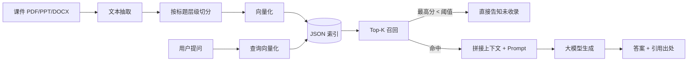

# 课程知识问答助手 · RAG Demo

把课件、讲义做成可检索的知识库，提问即得到**带出处**的答案。

一个跑通全链路的练习项目：文档解析 → 按标题切分 → 向量化入库 → 相似度检索 → 大模型生成 → 出处溯源。
代码量不大（核心约 400 行），重点是把每一环的取舍想清楚，而不是堆框架。

## 跑起来是什么样

不配 Key 也能跑（离线模式直接返回检索到的原文，用来验证链路）：

```
$ python ask.py "冒泡排序的时间复杂度是多少？"

【离线模式】未配置大模型 API，下面直接返回检索命中的原文片段，未做生成：

冒泡排序重复遍历待排序序列……时间复杂度：最好情况 O(n)，平均与最坏情况均为 O(n²)。
空间复杂度 O(1)，属于稳定排序。

（来源：数据结构-排序与查找.md · 1.1 冒泡排序）

出处：
  [1] 数据结构-排序与查找.md · 1.1 冒泡排序
  [2] 数据结构-排序与查找.md · 1.2 快速排序

（最高相似度 0.434）
```

问知识库里没有的东西时直接拒答，不给模型编的机会：

```
$ python ask.py "今天广州天气怎么样"

知识库中未收录与该问题相关的内容。可以换个问法，或先把对应课件加入 data/raw/ 重新建库。

（最高相似度 0.125）
```

---

## 为什么做这个

复习时最痛苦的不是没资料，而是资料散在几十个 PDF 和 PPT 里，知道"老师讲过"但找不到在哪一页。
把整门课塞进上下文既不经济也会丢细节，所以加一层检索：**先找到相关片段，再让模型基于片段回答，并标明出自哪个文件哪一节**。

## 功能

- 支持 `.pdf` / `.docx` / `.pptx` / `.md` / `.txt` 导入，按页抽取文本（PPT 按页，Word 按段并保留标题层级）
- 按标题层级切分，超长块按句末标点二次切分，相邻块保留重叠
- 增量导入：已入库的块（按 `chunk_id` 判定）自动跳过，新课件不必重建全库
- 回答附带 `[1] 文件名 第12页 · 小节` 形式的引用，编号由 chunk 元数据映射，不是模型自己写的
- **拒答兜底**：最高相似度低于阈值时直接回"未收录"，不交给模型自由发挥
- 切分粒度、召回数量、阈值都在 `config.toml` 里，可批量对比不同参数的效果

## 技术栈

| 环节 | 选型 | 为什么 |
|---|---|---|
| 语言 | Python 3.11+ | 用到标准库 `tomllib` 读配置，省一个 PyYAML |
| 文档解析 | `pymupdf` / `python-docx` / `python-pptx` | 按格式延迟导入，只装用得上的 |
| 向量化 | 任意 OpenAI 兼容 embedding 接口 | 换模型只改配置 |
| 向量库 | **纯 Python 余弦 + JSON** | 单机万级块用不着 FAISS，少一个依赖也看得清检索在做什么 |
| 生成模型 | 任意 OpenAI 兼容 chat 接口 | |
| 界面 | `gradio`（可选） | 只为演示，不追求工程化 |

## 整体流程



## 几个实现上的取舍

**1. 切分不是越细越好**
一开始按固定 500 字硬切，一个知识点被切成两半，检索到时上下文残缺。改成先按标题层级切语义块，只在超长块内部按 `。！？；` 断句，并保留 80 字重叠。块太大噪声高、太小语义不完整，平衡点落在 `max_chars=500, overlap=80`。

**2. 出处必须由数据带出来**
每个 chunk 入库时带 `{source, page, section}`，命中后按顺序编号写进 prompt，要求模型用 `[1]` 标注。答案里的引用是元数据映射出来的，模型编不出第 12 页的内容。

**3. 兜底比优化更重要**
没兜底时，问一个知识库里根本没有的问题，模型照样能编出像样的答案。加了相似度阈值后，未命中就明确说"未收录"——这一步对可信度的提升比调 prompt 明显得多。

**4. 参数用实验定，不靠感觉**
`scripts/compare_params.py` 对同一批问题跑不同的 `(max_chars, overlap, top_k)`，输出命中率与引用正确率对比表。

## 快速开始

```bash
git clone git@github.com:Castoricef/rag-course-qa.git
cd rag-course-qa
python -m venv .venv && source .venv/bin/activate   # Windows: .venv\Scripts\activate
pip install -r requirements.txt

# 1. 不配 Key 也能跑（离线模式，直接返回检索到的原文）
python ingest.py --src data/samples --index data/index
python ask.py "冒泡排序的时间复杂度是多少？"

# 2. 接入真实模型
cp .env.example .env      # 填 OPENAI_API_KEY / OPENAI_BASE_URL
python ingest.py --reset  # 换了 embedding 模型必须重建索引
python ask.py
```

配好 Key 后启动界面：

```bash
pip install gradio
python app.py
```

## 目录结构

```
.
├── ask.py                  # 命令行问答（单次 / 交互）
├── ingest.py               # 建库：解析 → 切分 → 向量化 → 落盘
├── app.py                  # Gradio 界面（可选）
├── config.toml             # 切分、召回、阈值、模型
├── src/
│   ├── loader.py           # 按格式解析，输出 (文本, 页码)
│   ├── splitter.py         # 标题切分 + 句末二次切分 + 重叠
│   ├── embedder.py         # embedding 客户端 / 离线哈希降级
│   ├── store.py            # 纯 Python 余弦检索 + JSON 持久化
│   ├── qa.py               # 检索 → 阈值判定 → 生成 → 引用拼装
│   └── config.py           # tomllib 读配置
├── scripts/
│   └── compare_params.py   # 参数对比实验
├── eval/questions.jsonl    # 评测问题集（问题 + 关键判据）
└── data/
    ├── samples/            # 内置示例（数据结构·排序与查找）
    ├── raw/                # 你自己的课件放这里
    └── index/              # 生成的索引（.gitignore）
```

## 实验记录

示例语料只有 1 篇文档、6 个 chunk，实测结果：

| max_chars | overlap | top_k | 命中率 | 引用正确率 |
|---|---|---|---|---|
| 300 | 30 | 3 | 100% | 100% |
| 500 | 50 | 3 | 100% | 100% |
| 500 | 50 | 5 | 100% | 100% |
| 800 | 80 | 3 | 100% | 100% |

**这组数字说明不了问题**——语料太小，top-3 必然包含正确块。换成你自己的整门课资料（几十篇课件、上千块）再跑，四组参数才会分出高下。这一条留着是为了说明：参数要拿数据选，不是拍脑袋定。

## 已知问题

- 扫描版 PDF 没有文本层，会直接跳过，暂不支持 OCR
- 公式、表格抽取后结构丢失，表格只保留"单元格 | 单元格"的文本串
- 不支持多轮对话，每轮独立检索，不带历史
- 离线模式的哈希向量是**词面匹配**，换个说法就召回不到，只能用来验证链路
- 中文没有做分词，英文按空格切，中英混排时偶尔切断英文单词

## TODO

- [ ] 接 PaddleOCR 处理扫描件
- [ ] 表格单独抽成结构化块，保留行列关系
- [ ] 加 rerank 提升 top-3 精度
- [ ] 支持按文件名 / 章节过滤检索范围
- [ ] 索引改用 SQLite，避免全量 JSON 反复读写

## License

MIT
